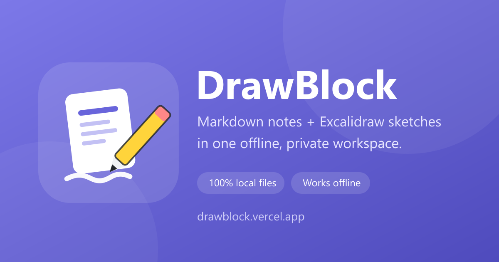

<p align="center">
  
</p>

<h1 align="center">DrawBlock</h1>

<p align="center">
  <strong>Catatan Anda. Sketsa Anda. Folder Anda. Aturan Anda.</strong><br />
  Workspace lokal dan offline yang mengubah folder apa pun menjadi basis pengetahuan Markdown + Excalidraw.
</p>

<p align="center">
  <a href="https://drawblock.vercel.app"></a>
  <a href="https://github.com/rivaldoismir/drawblock/actions/workflows/ci.yml"></a>
  <a href="LICENSE"></a>
  
  
  <a href="https://github.com/rivaldoismir/drawblock"></a>
  <a href="https://github.com/rivaldoismir/drawblock/graphs/traffic"></a>
  <a href="https://drawblock.vercel.app"></a>
</p>



## Kunjungan

<p>
  
  
  
  
</p>

Angka diperbarui setiap hari dari Vercel Web Analytics dan GitHub Traffic.
Semuanya agregat — tidak ada identitas pengunjung yang dikumpulkan. Kedua angka
menampilkan `n/a` sampai token yang diperlukan dikonfigurasi (lihat
[`docs/ANALYTICS.md`](docs/ANALYTICS.md#4-badge-jumlah-kunjungan-di-readme)).

## Mengapa DrawBlock?

Sebagian besar aplikasi catatan meminta Anda memindahkan pengetahuan ke cloud
mereka. DrawBlock melakukan sebaliknya: **arahkan ke folder yang sudah Anda
miliki** dan tetap bekerja seperti biasa.

- **File tetap milik Anda.** Catatan adalah file `.md` biasa, sketsa adalah JSON
  `.excalidraw` standar. Buka di editor apa pun, sinkronkan dengan Git, atau
  cadangkan dengan alat yang sudah Anda percaya. Tidak ada database dan tidak ada
  format proprietary.
- **Benar-benar offline.** Pasang sebagai PWA dan aplikasi tetap berjalan di
  pesawat, di kafe dengan Wi-Fi buruk, atau di mesin yang dibatasi. Font dan aset
  dibundel lokal; aplikasi tidak butuh server untuk membuka file Anda.
- **Dua alat, satu workspace.** Menulis di editor blok berbasis
  [BlockNote](https://github.com/TypeCellOS/BlockNote), membuat sketsa di
  [Excalidraw](https://github.com/excalidraw/excalidraw), lalu menautkan keduanya
  dengan tautan Markdown biasa.
- **Tanpa akun, tanpa lock-in, tanpa telemetri atas isi catatan.** DrawBlock
  meminta akses ke satu folder, menulis langsung ke sana, dan tidak pernah
  mengunggah isi catatan. Satu-satunya metrik opsional adalah hitungan kunjungan
  agregat tanpa cookie di demo yang di-host (lihat [Privasi](#privasi)).
- **Cepat dan sederhana.** Tanpa mesin sinkronisasi, tanpa daemon latar, tanpa
  migrasi mendadak. Hanya file, editor, dan kanvas.

## Coba dalam 30 detik

1. Buka **https://drawblock.vercel.app** di **Chrome atau Edge desktop**.
2. Klik **Buka Folder** dan pilih folder mana pun di komputer Anda.
3. Buat catatan atau sketsa lalu mulai menulis. Perubahan tersimpan otomatis
   setelah ~1–2 detik.
4. Opsional: gunakan ikon instal di address bar untuk memasang DrawBlock sebagai
   PWA desktop. Aplikasi tetap berjalan offline.

> DrawBlock memakai File System Access API, jadi butuh browser desktop berbasis
> Chromium. Firefox dan Safari sengaja belum didukung.

## Yang bisa dilakukan

| Fitur | Kegunaan |
| --- | --- |
| **Catatan Markdown** | Edit file `.md` di editor blok. Markdown tetap bersih — tanpa frontmatter, tanpa metadata tersembunyi. |
| **Sketsa Excalidraw** | Buat dan edit file `.excalidraw` yang juga bisa dibuka di excalidraw.com. |
| **Tautkan catatan dan sketsa** | Ketik `/` → *Tautan ke gambar* untuk menyisipkan tautan Markdown biasa ke sketsa. |
| **Manajemen file** | Buat, ganti nama, pindahkan, dan hapus file/folder langsung di disk. |
| **Pencarian** | Cari nama file dan isi catatan. Isi sketsa tidak pernah dibaca. |
| **Autosave dengan cek konflik** | Penulisan ber-debounce, antrean per path, dan pengecekan `lastModified` agar perubahan dari aplikasi lain tidak tertimpa diam-diam. |
| **PWA offline** | Font lokal, aset lokal, precache service worker, tema terang/gelap. |
| **Mode gelap** | Tombol manual di toolbar, diingat setelah reload. Default selalu terang. |

## Cara kerjanya

- **Markdown ↔ blok** selalu lewat `src/services/noteCodec.ts`, sehingga file di
  disk tetap portabel.
- **Sketsa** disimpan dengan `serializeAsJSON` dan dimuat dengan `loadFromBlob`;
  DrawBlock tidak pernah menyusun JSON Excalidraw secara manual.
- **Penulisan** lewat `createWritable()` dan `SaveQueue` dengan debounce, rantai
  per path, serta deteksi konflik.
- **Offline** dijaga dengan menyalin font Excalidraw ke `public/fonts/` dan
  menetapkan `window.EXCALIDRAW_ASSET_PATH = "/"`.

Aturan arsitektur lengkap ada di [`AGENTS.md`](AGENTS.md); keputusan produk ada di
[`.planning/`](.planning/).

## Pengembangan

Kebutuhan: **Node.js 20+**, npm, dan Chrome/Edge untuk pengujian manual.

```bash
npm install
npm run dev        # http://localhost:5173 (service worker nonaktif)
npm run typecheck
npm run test
npm run build
npm run preview    # http://localhost:4173 — wajib untuk uji PWA/offline
```

Tidak ada E2E otomatis. Perubahan UI diverifikasi manual di Chrome/Edge; daftar
periksanya ada di [`AGENTS.md`](AGENTS.md#verification-checklist).

Skrip tambahan:

```bash
npm run sync:fonts   # salin font Excalidraw ke public/fonts (otomatis)
npm run stats:repo   # tampilkan traffic GitHub + bintang repo ini
```

## Privasi

- DrawBlock hanya membaca dan menulis folder yang Anda pilih. Tidak ada unggahan.
- Demo yang di-host memakai **Vercel Web Analytics**: kunjungan agregat, tanpa
  cookie, tanpa pelacakan lintas situs, dan tanpa akses ke isi catatan. Skripnya
  same-origin dan hanya berjalan di host produksi. Sesi offline tidak mengirim
  request. Nonaktifkan dengan menghapus blok `inject()` di `src/main.tsx` atau
  mematikan Analytics di proyek Vercel.
- Untuk mengukur minat pada repo, dipakai **Traffic** bawaan GitHub (views,
  clones, referrers). Tidak ada tracker pihak ketiga.
- Detail metrik, batasan, dan cara opt-out ada di
  [`docs/ANALYTICS.md`](docs/ANALYTICS.md).

## Dibangun dengan — dan layak dibantu

DrawBlock tidak akan ada tanpa dua proyek open source hebat ini. Jika DrawBlock
menghemat waktu Anda, beri mereka bintang, laporkan bug, atau kontribusikan
perbaikan. Itu "terima kasih" terbaik dalam open source.

<table>
  <tr>
    <td width="50%" valign="top">
      <h3><a href="https://github.com/excalidraw/excalidraw">Excalidraw</a></h3>
      <p>Kanvas gambar tangan di balik setiap sketsa <code>.excalidraw</code>.</p>
      <p><strong>Lisensi:</strong> MIT</p>
      <p>
        <a href="https://github.com/excalidraw/excalidraw">⭐ Bintang / pakai</a> ·
        <a href="https://github.com/excalidraw/excalidraw/blob/master/CONTRIBUTING.md">Berkontribusi</a> ·
        <a href="https://github.com/excalidraw/excalidraw/issues">Laporkan bug</a>
      </p>
    </td>
    <td width="50%" valign="top">
      <h3><a href="https://github.com/TypeCellOS/BlockNote">BlockNote</a></h3>
      <p>Editor blok yang menjaga catatan DrawBlock tetap terbaca sebagai Markdown murni.</p>
      <p><strong>Lisensi:</strong> MPL-2.0</p>
      <p>
        <a href="https://github.com/TypeCellOS/BlockNote">⭐ Bintang / pakai</a> ·
        <a href="https://github.com/TypeCellOS/BlockNote/blob/main/CONTRIBUTING.md">Berkontribusi</a> ·
        <a href="https://github.com/TypeCellOS/BlockNote/issues">Laporkan bug</a>
      </p>
    </td>
  </tr>
</table>

Notice lisensi pihak ketiga ada di
[`THIRD-PARTY-NOTICES.md`](THIRD-PARTY-NOTICES.md).

## Berkontribusi ke DrawBlock

Laporan bug, ide fitur, perbaikan dokumentasi, dan pull request sangat diterima.
Mulai dari [`CONTRIBUTING.md`](CONTRIBUTING.md) dan patuhi
[Code of Conduct](CODE_OF_CONDUCT.md).

- 🐛 [Laporkan bug](https://github.com/rivaldoismir/drawblock/issues/new/choose)
- 💡 [Usulkan fitur](https://github.com/rivaldoismir/drawblock/issues/new/choose)
- 🔐 [Laporkan masalah keamanan secara privat](SECURITY.md)
- ⭐ Beri bintang jika ingin lebih banyak orang menemukannya

## Lisensi

DrawBlock dirilis di bawah [MIT License](LICENSE).

Excalidraw berlisensi MIT. BlockNote berlisensi MPL-2.0. Lihat
[`THIRD-PARTY-NOTICES.md`](THIRD-PARTY-NOTICES.md) untuk detailnya.
