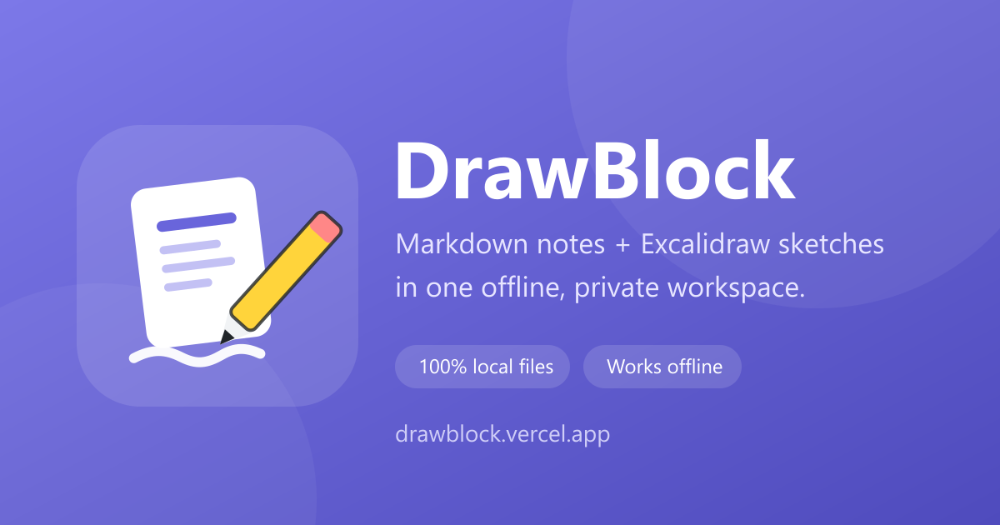

<p align="center">
  
</p>

<h1 align="center">DrawBlock</h1>

<p align="center">
  <strong>Your notes. Your sketches. Your folder. Your rules.</strong><br />
  A private, offline-first workspace that turns any folder into a Markdown + Excalidraw knowledge base.
</p>

<p align="center">
  <a href="https://drawblock.vercel.app"></a>
  <a href="https://github.com/rivaldoismir/drawblock/actions/workflows/ci.yml"></a>
  <a href="LICENSE"></a>
  
  
  <a href="https://github.com/rivaldoismir/drawblock/graphs/traffic"></a>
  <a href="https://drawblock.vercel.app"></a>
</p>



## Visits

<p>
  
  
  
  
</p>

Counters are refreshed daily from Vercel Web Analytics and GitHub Traffic. They
are aggregate only — no visitor identities are collected. App counters show
`n/a` until the Vercel token is configured (see
[`docs/ANALYTICS.md`](docs/ANALYTICS.md#badge-jumlah-kunjungan-di-readme));
repository counters work without any extra secret.

## Why DrawBlock?

Most note apps ask you to move your knowledge into their cloud. DrawBlock does the
opposite: **point it at a folder you already own** and keep working the way you
already do.

- **Your files stay yours.** Notes are plain `.md` files, sketches are standard
  `.excalidraw` JSON. Open them in any editor, sync them with Git, or back them up
  with the tool you already trust. There is no database and no proprietary format.
- **Actually offline.** Install it as a PWA and it keeps working on a plane, in a
  café with bad Wi-Fi, or on a locked-down machine. Fonts and assets are bundled
  locally; the app never needs a server to open your files.
- **Two tools, one workspace.** Write in a clean block editor powered by
  [BlockNote](https://github.com/TypeCellOS/BlockNote), sketch in
  [Excalidraw](https://github.com/excalidraw/excalidraw), and link the two with
  ordinary Markdown links.
- **No account, no lock-in, no telemetry on your content.** DrawBlock asks for
  access to one folder, writes directly to it, and never uploads a byte of your
  notes. The only optional metric is aggregate, cookie-less page-view counting on
  the hosted demo (see [Privacy](#privacy)).
- **Fast and boring in the best way.** No sync engine, no background daemon, no
  surprise migrations. Just files, an editor, and a canvas.

## Try it in 30 seconds

1. Open **https://drawblock.vercel.app** in **Chrome or Edge on desktop**.
2. Click **Buka Folder** and pick any folder on your computer.
3. Create a note or a sketch and start typing. Changes are saved automatically
   after ~1–2 seconds.
4. Optional: use the install icon in the address bar to install DrawBlock as a
   desktop PWA. It will keep working offline.

> DrawBlock uses the File System Access API, so it needs a Chromium-based desktop
> browser. Firefox and Safari are intentionally not supported yet.

## What you can do

| Feature | What it does |
| --- | --- |
| **Markdown notes** | Edit `.md` files in a block editor. Markdown stays clean — no frontmatter, no hidden metadata. |
| **Excalidraw sketches** | Create and edit `.excalidraw` files that also open on excalidraw.com. |
| **Link notes and sketches** | Type `/` → *Tautan ke gambar* to insert a normal Markdown link to a sketch. |
| **File management** | Create, rename, move, and delete files and folders directly on disk. |
| **Search** | Search file names and note contents. Sketch contents are never read. |
| **Autosave with conflict checks** | Debounced writes, a per-path queue, and `lastModified` checks so external edits are never silently overwritten. |
| **Offline PWA** | Local fonts, local assets, service worker precache, light/dark theme. |
| **Dark mode** | A manual toggle in the toolbar, remembered across reloads. Light is the default. |

## How it works

- **Markdown ↔ blocks** always goes through `src/services/noteCodec.ts`, so the
  file on disk stays portable.
- **Sketches** are saved with Excalidraw's `serializeAsJSON` and loaded with
  `loadFromBlob`; DrawBlock never builds Excalidraw JSON by hand.
- **Writes** go through `createWritable()` and a `SaveQueue` with debounce,
  per-path chaining, and conflict detection.
- **Offline** is enforced by bundling Excalidraw fonts into `public/fonts/` and
  setting `window.EXCALIDRAW_ASSET_PATH = "/"`.

See [`AGENTS.md`](AGENTS.md) for the full architectural rules and
[`.planning/`](.planning/) for the product decisions.

## Development

Requirements: **Node.js 20+**, npm, and Chrome/Edge for manual testing.

```bash
npm install
npm run dev        # http://localhost:5173 (service worker disabled)
npm run typecheck
npm run test
npm run build
npm run preview    # http://localhost:4173 — required to test PWA/offline
```

There is no automated E2E suite. UI changes are verified manually in Chrome/Edge;
the checklist is in [`AGENTS.md`](AGENTS.md#verification-checklist).

Useful scripts:

```bash
npm run sync:fonts   # copy Excalidraw fonts into public/fonts (runs automatically)
npm run stats:repo   # print GitHub traffic + stars for this repository
```

## Privacy

- DrawBlock reads and writes only the folder you choose. Nothing is uploaded.
- The hosted demo uses **Vercel Web Analytics**: aggregate page views, no cookies,
  no cross-site tracking, and no access to note contents. The script is
  same-origin and only runs on the production host. Offline sessions emit no
  request. You can remove it by deleting the `inject()` block in `src/main.tsx`
  or turning Analytics off in the Vercel project.
- To measure repository interest, GitHub's own **Traffic** insights are used
  (views, clones, referrers). No third-party tracker is added.
- Read [`docs/ANALYTICS.md`](docs/ANALYTICS.md) for the exact metrics, limits, and
  how to opt out.

## Built with — and worth contributing to

DrawBlock would not exist without two excellent open-source projects. If DrawBlock
saves you time, please give them a star, report a bug, or contribute a fix. That
is the best "thank you" open source can get.

<table>
  <tr>
    <td width="50%" valign="top">
      <h3><a href="https://github.com/excalidraw/excalidraw">Excalidraw</a></h3>
      <p>The hand-drawn canvas behind every <code>.excalidraw</code> sketch.</p>
      <p><strong>License:</strong> MIT</p>
      <p>
        <a href="https://github.com/excalidraw/excalidraw">⭐ Star / use it</a> ·
        <a href="https://github.com/excalidraw/excalidraw/blob/master/CONTRIBUTING.md">Contribute</a> ·
        <a href="https://github.com/excalidraw/excalidraw/issues">Report a bug</a>
      </p>
    </td>
    <td width="50%" valign="top">
      <h3><a href="https://github.com/TypeCellOS/BlockNote">BlockNote</a></h3>
      <p>The block editor that keeps DrawBlock notes readable as plain Markdown.</p>
      <p><strong>License:</strong> MPL-2.0</p>
      <p>
        <a href="https://github.com/TypeCellOS/BlockNote">⭐ Star / use it</a> ·
        <a href="https://github.com/TypeCellOS/BlockNote/blob/main/CONTRIBUTING.md">Contribute</a> ·
        <a href="https://github.com/TypeCellOS/BlockNote/issues">Report a bug</a>
      </p>
    </td>
  </tr>
</table>

Third-party license notices are in [`THIRD-PARTY-NOTICES.md`](THIRD-PARTY-NOTICES.md).

## Contributing to DrawBlock

Bug reports, feature ideas, documentation fixes, and pull requests are welcome.
Start with [`CONTRIBUTING.md`](CONTRIBUTING.md), and please follow the
[Code of Conduct](CODE_OF_CONDUCT.md).

- 🐛 [Report a bug](https://github.com/rivaldoismir/drawblock/issues/new/choose)
- 💡 [Request a feature](https://github.com/rivaldoismir/drawblock/issues/new/choose)
- 🔐 [Report a security issue privately](SECURITY.md)
- ⭐ Star the repo if you want more people to find it

## License

DrawBlock is released under the [MIT License](LICENSE).

Excalidraw is MIT-licensed. BlockNote is MPL-2.0. See
[`THIRD-PARTY-NOTICES.md`](THIRD-PARTY-NOTICES.md) for details.
